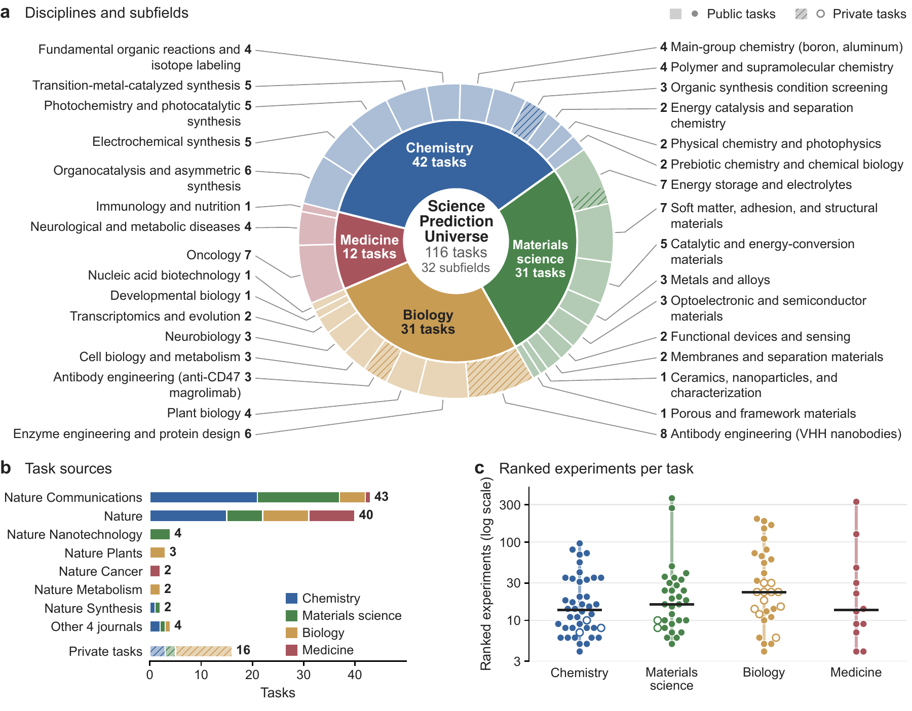
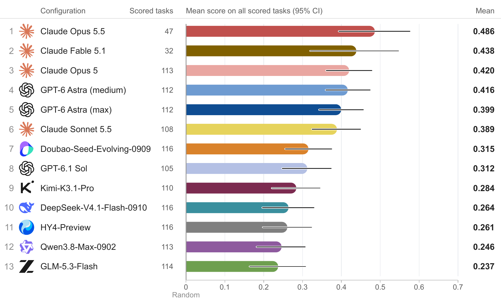
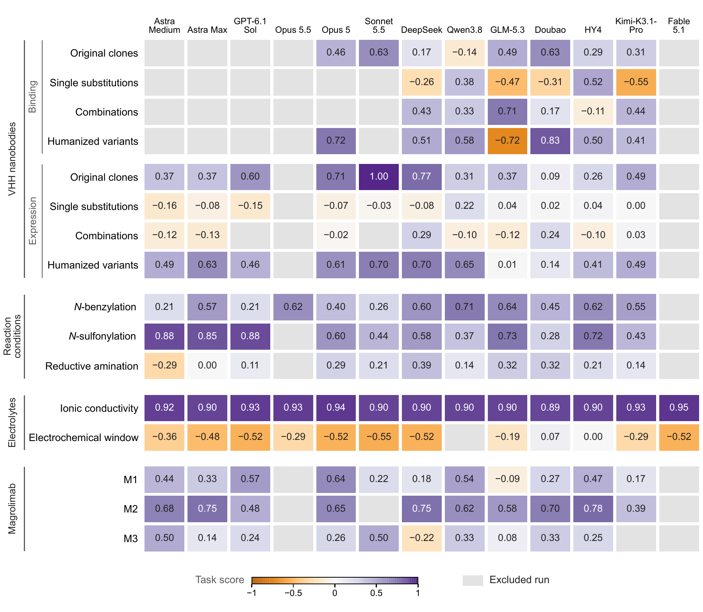
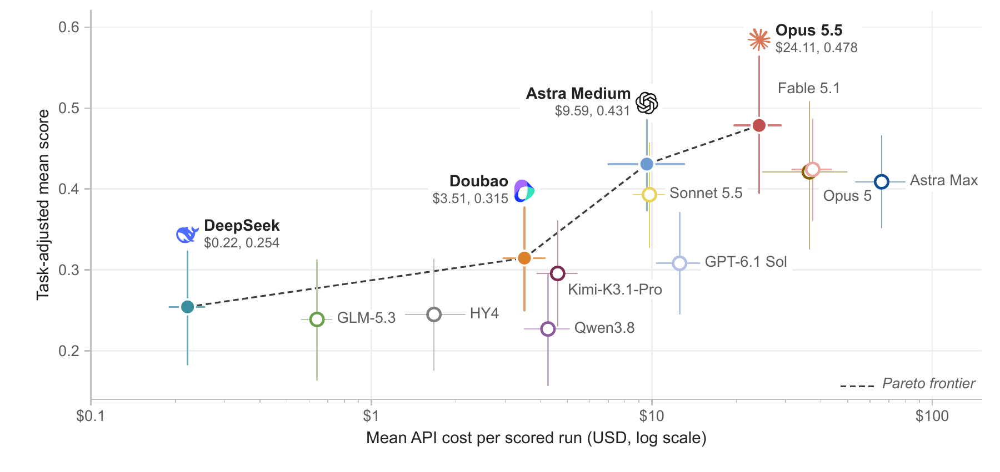
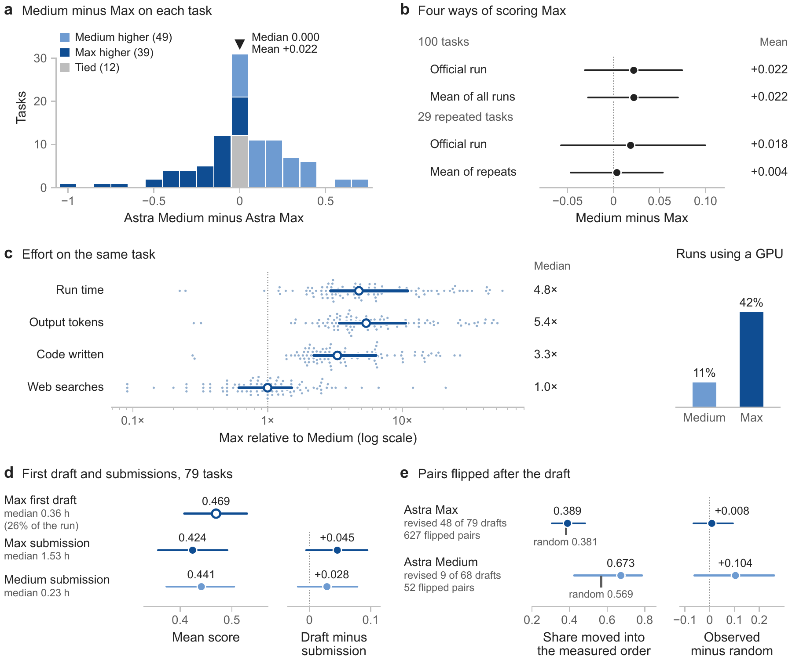
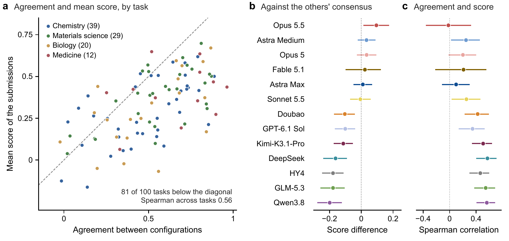
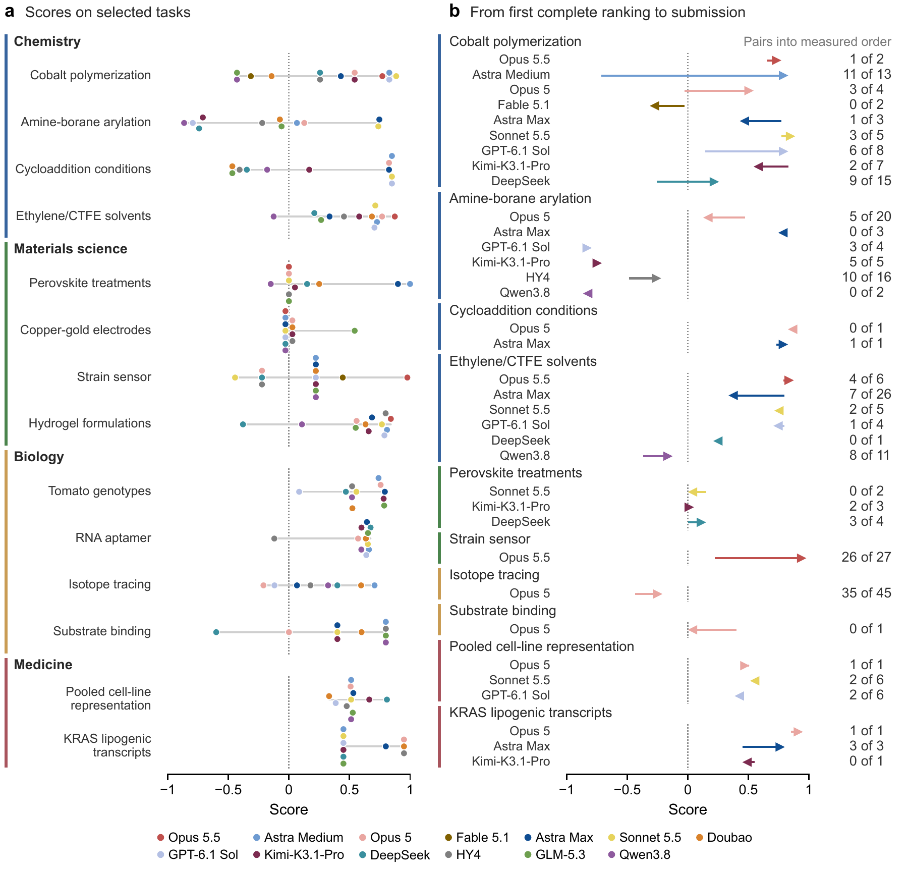
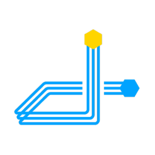

Title: Science Prediction Universe
Date: 2026-10-31
Summary: Can an AI agent predict how a real experiment turns out? Inside SPU: 100 public tasks, 16 private tasks, and what agent trajectories suggest about scientific reasoning.
HeaderImage: /static/images/sle/spu-ranking-v4.png

Science Prediction Universe (SPU) tests whether an AI agent can predict how a wet-lab experiment turns out, using only the information a scientist has before running it. The agent ranks the candidates by their measured outcome and is scored against measurements it never sees. SPU has 100 public tasks built from recent Nature Portfolio papers and 16 private tasks from experiments that have never been published.

<!-- SLE_RESOURCES -->

<b>UniPat AI</b> · <a href="#sle-contributors">Contributors</a>

<nav class="sle-toc" aria-label="SPU article sections">

On this page
<progress max="100" value="0" aria-label="Article reading progress"></progress><ol><li><a href="#sle-question">Overview</a></li><li><a href="#sle-setting">Inside a task</a></li><li><a href="#sle-safeguards">Guarding against shortcuts</a></li><li><a href="#sle-results">Leaderboard</a></li><li><a href="#sle-analysis">Analysis</a></li><li><a href="#sle-source">Data release</a></li><li><a href="#sle-outlook">Outlook</a></li><li><a href="#sle-contributors">Contributors</a></li></ol>
</nav>

<blockquote class="sle-blog-quote">
“If it disagrees with experiment, it’s wrong. In that simple statement is the key to science.”
<cite>Richard Feynman</cite></blockquote>
<section id="sle-question"><h2>What SPU measures</h2>

AI agents can now search the literature, run quantum-chemistry and molecular-dynamics calculations, and write analysis code for hours on their own. But many questions in experimental science have no computed answer. Which electrolyte additive makes a zinc battery last longer? Which enzyme variant pushes an oxidation toward the desired product? Computation can narrow the candidates, but the answer comes from synthesis and measurement. <strong>SPU tests whether an agent can decide which evidence and which calculations matter for the quantity being measured, and then commit to a prediction without any experimental feedback.</strong>

<figure class="sle-paper-figure"><figcaption>One official run on an SPU task. The task has 13 copper-catalyzed arylation reactions of the same amine-borane that differ only in the base, and the agent must rank them by measured NMR yield. GPT-6 Astra at max effort worked in Codex for 6.6 of its 8 hours, used the web only through the audited service and revised its ranking twice. The measured yields stay in a separate grading container. The submission scored 0.75, above the task&#x27;s chance threshold of 0.47. This run was among the longest quarter of official runs for the same configuration.</figcaption></figure>

<article><strong>116</strong>
Tasks: 100 public, 16 private
</article><article><strong>85</strong>
Source papers in 11 Nature Portfolio journals
</article><article><strong>4,207</strong>
Ranked wet-lab experiments
</article><article><strong>8 h</strong>
Per run, with open web and one H20 GPU
</article>

Other benchmarks cover parts of this. Outcome-prediction benchmarks such as BrainBench ask about real experimental results, usually as a single question to a model without tools. Agentic science benchmarks let agents write and run code on data that is already in hand, and long-horizon container benchmarks grade answers with fixed tests. SPU gives an agent hours of compute and open web access and scores it against real wet-lab measurements.

How SPU compares with related benchmarks

<table><caption>Benchmark settings compared in the manuscript</caption>
<thead>
<tr>
<th>Benchmark</th>
<th>Domain</th>
<th>Output</th>
<th>Wet-lab outcome</th>
<th>Agentic compute</th>
<th>Hours-long runs</th>
<th>Open web</th>
</tr>
</thead>
<tbody>
<tr>
<th scope="row">Humanity's Last Exam</th>
<td>Multi-discipline</td>
<td>Closed-ended QA</td>
<td>✗</td>
<td>✗</td>
<td>✗</td>
<td>✗</td>
</tr>
<tr>
<th scope="row">BrainBench</th>
<td>Neuroscience</td>
<td>2-way choice</td>
<td>✓</td>
<td>✗</td>
<td>✗</td>
<td>✗</td>
</tr>
<tr>
<th scope="row">SciPredict</th>
<td>Phys. / Chem. / Bio.</td>
<td>Answer or value</td>
<td>✓</td>
<td>✗</td>
<td>✗</td>
<td>✗</td>
</tr>
<tr>
<th scope="row">ProteinGym</th>
<td>Protein fitness</td>
<td>Spearman ranking</td>
<td>✓</td>
<td>✗</td>
<td>✗</td>
<td>✗</td>
</tr>
<tr>
<th scope="row">AssayBench †</th>
<td>CRISPR screens</td>
<td>Gene ranking</td>
<td>✓</td>
<td>△</td>
<td>✗</td>
<td>✗</td>
</tr>
<tr>
<th scope="row">ScienceAgentBench</th>
<td>Data-driven science</td>
<td>Program</td>
<td>✗</td>
<td>✓</td>
<td>✗</td>
<td>✗</td>
</tr>
<tr>
<th scope="row">Terminal-Bench-Science</th>
<td>Five scientific domains</td>
<td>Tested artifact</td>
<td>✗</td>
<td>✓</td>
<td>n/s</td>
<td>n/s</td>
</tr>
<tr>
<th scope="row">Agents' Last Exam</th>
<td>Tool-use tasks</td>
<td>Task state or answer</td>
<td>✗</td>
<td>✓</td>
<td>✓</td>
<td>△</td>
</tr>
<tr>
<th scope="row">Terminal-Bench 4.0</th>
<td>Mixed</td>
<td>Tested state</td>
<td>✗</td>
<td>✓</td>
<td>✓</td>
<td>△</td>
</tr>
<tr>
<th scope="row">Long-Horizon-TB</th>
<td>Mixed</td>
<td>Graded subtasks</td>
<td>✗</td>
<td>✓</td>
<td>✓</td>
<td>n/s</td>
</tr>
<tr>
<th scope="row"><strong>SPU (ours)</strong></th>
<td>Chem. / Mat. / Bio. / Med.</td>
<td>Ranking</td>
<td>✓</td>
<td>✓</td>
<td>✓</td>
<td>✓ policy + screening</td>
</tr>
</tbody>
</table>

✓ yes · △ partly · ✗ no · n/s not stated. △ under Open web: web access is allowed and the agent is told not to look up answers, but this is not audited. † AssayBench evaluates agent baselines alongside direct LLM prediction. The columns show what SPU is designed to test; several of these benchmarks are stronger on things not shown here, such as scale, human baselines or prospective design.

</section>
<section id="sle-setting"><h2>What does an SPU task look like?</h2>

A task describes a set of experiments from one study: the candidates, materials and conditions, and how the result was measured. The experiments are split into comparison groups, each with one measured quantity such as a reaction yield or an ionic conductivity, and the agent orders each group from the lowest to the highest value. It works alone for up to eight hours in a container with 8 CPU cores, 16 GiB of memory, one NVIDIA H20 GPU and internet access. Each experiment carries an anonymous ID, and the agent is never told which study the task comes from.

When the agent stops, a separate container without network access compares its ranking with the measurements using Spearman correlation. Random valid rankings average 0; 1 is perfect agreement when the measurements have no ties. Ties make the attainable maximum slightly lower on some tasks. Small tasks can score well by luck, so each task also has a chance threshold: the score that only 5% of 4,000 random rankings exceed. Scoring is automatic, and no model acts as a judge.

More than ten experts built the public tasks from studies that report full measurements. They left out comparisons that simply follow a trend, such as a concentration series, and comparisons whose values are so close that the order could come from measurement error. Each task was reviewed independently against its sources, and the final 100 were chosen after pilot runs with agents. The private tasks come from four series of unpublished experiments run with partner labs, on VHH nanobodies, reaction conditions, electrolytes and variants of the antibody Magrolimab. All were measured with replicates, and no model scores were used to choose them.

<figure class="sle-paper-figure"><figcaption>Coverage of SPU. (a) The 116 tasks by discipline and subfield; hatching marks private tasks. (b) Source journals of the public tasks, and the four private series. (c) Number of experiments per task (log scale).</figcaption></figure>
</section>
<section id="sle-safeguards"><h2>Can&#x27;t an agent just look the answer up?</h2>

Public tasks come from published papers, and the agents can search the web. SPU uses four safeguards. The source papers are recent. The instructions forbid using the source study or recalling its results, and an agent whose search turns up a forbidden result must stop and record it. Scoring happens in an isolated container, and every trajectory is kept for review. Finally, the private tasks cannot be found online at all.

We checked two possible shortcuts. Submitting the experiments in their listed order gives a mean score below every configuration. Runs flagged for source identifiers, such as a DOI, showed no detectable score advantage within any configuration after correction for multiple comparisons. These checks do not rule out contamination.

<figure class="sle-paper-figure"><figcaption>Guarding against shortcuts. (a) What the agent can reach, what the audited service records and what stays in the grading container. (b) Score of the listed order on each task, against the task&#x27;s chance threshold. (c) How often each configuration&#x27;s runs showed signs of memory or outside network use. (d) Score difference between runs that came across source identifiers and the other runs of the same configuration. Source-identifier flags record exposure, not proof that a forbidden result was used.</figcaption></figure>
</section>
<section id="sle-results"><h2>How do current agents compare?</h2>

We tested twelve frontier models in thirteen configurations, where a configuration is a model with its reasoning effort and agent harness. GPT-6 Astra ran in Codex at medium and at max reasoning effort. GPT-6.1 Sol also ran in Codex, and the other ten models ran in Claude Code, all at max effort. The main comparison uses one official run per configuration on every task.

<article><strong>0.478</strong>
Best score on the public tasks (task-adjusted Spearman)
</article><article><strong>34–52%</strong>
Share of scored tasks above chance, across configurations
</article><article><strong>12 of 13</strong>
Configurations above chance on the private tasks
</article><article><strong>4.8×</strong>
Longer median runs at max effort, with no detectable score gain
</article>

<figure class="sle-paper-figure"><figcaption>Configurations ranked by mean score over all their scored tasks, public and private, with 95% bootstrap intervals. Claude Opus 5.5 and Claude Fable 5.1 are scored on fewer tasks because most of their runs ended in safety refusals. This chart averages public and private tasks without adjustment, so its numbers differ slightly from the table below.</figcaption></figure>

<strong>SPU is far from solved.</strong> Even the best configurations beat chance on only about half of their scored tasks. The point estimates form two broad groups: every difference that holds up statistically (17 pairs after Holm correction) separates configurations in the leading six from those in the other seven, and one run per task is not enough to order the configurations within a tier. Claude Opus 5.5 and Claude Fable 5.1 were scored on fewer tasks because of frequent safety refusals, especially outside materials science, so their averages rest mostly on materials-science tasks.

<table><caption>Public tasks · task-adjusted scores and coverage</caption>
<thead>
<tr>
<th>#</th>
<th>Configuration</th>
<th>Harness</th>
<th>Scored tasks</th>
<th>Task-adjusted mean [95% CI]</th>
<th>Above chance</th>
</tr>
</thead>
<tbody>
<tr>
<td>1</td>
<th scope="row"><strong>Claude Opus 5.5</strong></th>
<td>Claude Code</td>
<td>44</td>
<td><strong>0.478</strong> [0.395, 0.564]</td>
<td>23 (52%)</td>
</tr>
<tr>
<td>2</td>
<th scope="row">GPT-6 Astra (medium)</th>
<td>Codex</td>
<td>100</td>
<td>0.431 [0.373, 0.486]</td>
<td>52 (52%)</td>
</tr>
<tr>
<td>3</td>
<th scope="row">Claude Opus 5</th>
<td>Claude Code</td>
<td>99</td>
<td>0.424 [0.361, 0.487]</td>
<td>51 (52%)</td>
</tr>
<tr>
<td>4</td>
<th scope="row">Claude Fable 5.1</th>
<td>Claude Code</td>
<td>30</td>
<td>0.421 [0.326, 0.508]</td>
<td>14 (47%)</td>
</tr>
<tr>
<td>5</td>
<th scope="row">GPT-6 Astra (max)</th>
<td>Codex</td>
<td>100</td>
<td>0.409 [0.352, 0.466]</td>
<td>50 (50%)</td>
</tr>
<tr>
<td>6</td>
<th scope="row">Claude Sonnet 5.5</th>
<td>Claude Code</td>
<td>97</td>
<td>0.393 [0.328, 0.457]</td>
<td>46 (47%)</td>
</tr>
<tr>
<td>7</td>
<th scope="row">Doubao-Seed-Evolving-0909</th>
<td>Claude Code</td>
<td>100</td>
<td>0.315 [0.250, 0.377]</td>
<td>37 (37%)</td>
</tr>
<tr>
<td>8</td>
<th scope="row">GPT-6.1 Sol (max)</th>
<td>Codex</td>
<td>94</td>
<td>0.308 [0.246, 0.371]</td>
<td>35 (37%)</td>
</tr>
<tr>
<td>9</td>
<th scope="row">Kimi-K3.1-Pro</th>
<td>Claude Code</td>
<td>95</td>
<td>0.296 [0.230, 0.361]</td>
<td>34 (36%)</td>
</tr>
<tr>
<td>10</td>
<th scope="row">DeepSeek-V4.1-Flash-0910</th>
<td>Claude Code</td>
<td>100</td>
<td>0.254 [0.183, 0.323]</td>
<td>36 (36%)</td>
</tr>
<tr>
<td>11</td>
<th scope="row">HY4-Preview</th>
<td>Claude Code</td>
<td>100</td>
<td>0.245 [0.176, 0.313]</td>
<td>36 (36%)</td>
</tr>
<tr>
<td>12</td>
<th scope="row">GLM-5.3-Flash</th>
<td>Claude Code</td>
<td>98</td>
<td>0.239 [0.164, 0.312]</td>
<td>33 (34%)</td>
</tr>
<tr>
<td>13</td>
<th scope="row">Qwen3.8-Max-0902</th>
<td>Claude Code</td>
<td>98</td>
<td>0.227 [0.157, 0.296]</td>
<td>35 (36%)</td>
</tr>
</tbody>
</table>

Public tasks only. Configurations were scored on different sets of tasks, so each mean is adjusted for task difficulty; brackets give 95% bootstrap intervals over tasks. Above chance counts the tasks where a configuration beat the task's chance threshold.

On the 28 tasks scored by all thirteen configurations—27 public and one private—the leading six still hold the first six places, in a different order. This common set reproduces the two groups without settling the order within each.

On the 16 private tasks, whose results have never been published, 159 of 208 official runs were scored. Twelve of the thirteen configurations rank significantly better than chance. Scores depend strongly on what is being measured, and no two configurations differ detectably. Every configuration ranks the ionic conductivity of the electrolytes almost perfectly, but none of the scored configurations beats chance on the electrochemical window of the same solutions.

<figure class="sle-paper-figure"><figcaption>Scores on the private tasks, grouped into the VHH nanobody, reaction-condition, electrolyte and Magrolimab series. Gray cells mark excluded runs: refusals, one timeout and one policy stop without a usable ranking.</figcaption></figure>

The average API cost of a scored run ranges 300-fold across configurations. DeepSeek-V4.1-Flash-0910, Doubao-Seed-Evolving-0909, GPT-6 Astra (medium) and Claude Opus 5.5 form the cost-performance frontier: for each of them, no other configuration is both cheaper and better. Among the five cheapest configurations, the biggest spender has the lowest score.

<figure class="sle-paper-figure"><figcaption>Estimated API cost per scored run against task-adjusted mean score on the public tasks, with 95% bootstrap intervals. Filled markers joined by the dashed line form the cost-performance frontier. Estimates use provider API prices checked on 20 October 2026, with GPT-6.1 Sol and Claude Opus 5 checked on 23 October, Kimi-K3.1-Pro on 26 October and Claude Sonnet 5.5 on 29 October. Recorded cache usage is included; hardware costs are excluded.</figcaption></figure>
</section>
<section id="sle-analysis"><h2>Why do predictions fall short?</h2>

We analyzed all 1,155 scored runs on the public tasks, 227,103 tool calls in total. Expert reviews of selected runs point to scientific failure modes: agents compute a quantity that is easy to calculate but does not control what the experiment measured, or revise a good early ranking based on assumptions they never checked.

<h3>More computation did not bring a detectable accuracy gain.</h3>

Switching GPT-6 Astra from medium to max effort makes a run 4.8 times longer and 5.3 times more expensive (medians), without a detectable improvement in score. On the 79 tasks with a recoverable first complete ranking, max effort produces that draft a median of 26% of the way into the run. Its mean score is 0.469, compared with 0.424 for the final submission; the difference is not statistically significant. Its later swaps do not detectably outperform random swaps at the same distance in the draft. Across all thirteen configurations, scores show no detectable correlation with run time, tool calls, web fetches or GPU use after correction for multiple comparisons.

<figure class="sle-paper-figure"><figcaption>GPT-6 Astra at medium and max effort. (a, b) Score differences per task and on average. (c) Max relative to Medium on the same task: run time, output, code, web searches and GPU use. (d) Max&#x27;s first complete ranking compared with the two final submissions. (e) Pairs Max swapped after its first draft, compared with random swaps.</figcaption></figure>

<h3>Agents agree with one another more than with the experiment.</h3>

Agents lean on the same simple assumptions. When the items in a group differ in a number such as temperature or composition, agents often just sort by that number: among 95 eligible groups from 37 tasks, about a quarter of submissions follow such a monotone order, compared with 11% of measured orders. The configurations also agree with each other (0.52 Spearman on an average task) more than with the measurements (0.33).

<figure class="sle-paper-figure"><figcaption>(a) For each public task, how much the configurations agree with each other against how well they score; agreement is higher on 81 of the 100 tasks. (b) Each configuration&#x27;s score minus that of the other configurations&#x27; consensus. (c) Within each configuration, how a run&#x27;s agreement with that consensus correlates with its score.</figcaption></figure>

<h3>Good runs model the quantity the experiment measured.</h3>

After correcting for multiple comparisons, none of the annotated methods or behaviors shows a detectable association with higher scores across the 1,155 scored public runs. We read one high-scoring run per discipline in detail; they were picked as examples, so they show how a good run works but not how often it happens. Each ranked the candidates by the quantity the experiment measured, and run length made little difference: the two multi-hour runs beat chance by no more than the two that finished within an hour.

Low-scoring runs often applied the same methods to the wrong quantity or the wrong molecule. On a task that ranks ligands for a cobalt-catalyzed polymerization by the conversion they give, GPT-6 Astra (medium), GLM-5.3-Flash and Qwen3.8-Max-0902 all ran semiempirical calculations and a kinetic model. They scored 0.829, −0.429 and −0.429, and they were not modeling the same chemical species: one run built the ligand with the wrong stereochemistry, and another left out hydrogen atoms even though its own tool output reported them missing.

<figure class="sle-paper-figure"><figcaption>(a) Scores of all scored runs on the tasks we read in detail, by discipline. (b) For runs that changed their first complete ranking, the score before and after, and how many swapped pairs moved into the measured order.</figcaption></figure>
</section>
<section id="sle-source"><h2>100 public tasks, 16 private tasks</h2>

<article><h3>100 · Public tasks</h3>
We plan to release the complete Harbor task packages, including task inputs, environments, scoring code and reference answers, so others can run and score them independently. During evaluation, reference answers stay in a separate grading container, hidden from the agent. Published results may eventually enter training data, so evaluation reports should state each model's training cutoff.
</article><article><h3>16 · Private tasks</h3>
These stay private for controlled evaluation. Their experimental measurements are unpublished and kept out of the public task release. We plan to add more private tasks over time and to retire public tasks if we detect contamination.
</article>

</section>
<section id="sle-outlook"><h2>Agents need to identify what controls a measurement.</h2>

Within the eight-hour budget studied here, longer runs and heavier simulations did not bring a detectable improvement in prediction accuracy. To close the gap between computation and real experiments, agents will need to work out which mechanism controls a measured result and test their own physical assumptions before committing to a prediction.

</section>
<section id="sle-contributors"><h2>Contributors</h2>

<strong>Project Team</strong>Zengji Tu1*Xiang Liu1*Jiarui Sun1Ruoyu Wu1Zhihui Qi1Chengda Wu1Yutao Zhou1Bo Yang1Ziyan Zhang1Jialong Wu1Liang Chen1†Kuan Li1†

<strong>Advisory Committee</strong>Steven Dillmann2Yuanqi Du3Soojung Yang4Shizhe Diao5Jianjun Wu6Junlang Liu7Xuming Hu8Lin Chang6,9†Baobao Chang10Xiaowen Chu8Philip S. Yu11Tong-Yi Zhang8,12

<strong>Wet-Lab Collaborators</strong>Hao Cheng13Qin Han13Yanye Feng14Chenru Duan15Chuncheng Liu15Yan Liu15Yuchen Gao15Zhao Li15Ronghua Zhang15Tory Xu15Renjian Song16Yaokai Fu16

<ul class="sle-institution-marks" aria-label="Institutions"><li></li><li></li><li></li><li></li><li></li><li></li><li></li><li></li><li></li><li></li><li></li><li></li><li></li></ul>

<h3>Affiliations</h3><ol class="sle-affiliations" aria-label="Author affiliations">
<li value="1">1UniPat AI</li>
<li value="2">2Stanford University</li>
<li value="3">3Cornell University</li>
<li value="4">4FutureHouse</li>
<li value="5">5The Hong Kong University of Science and Technology</li>
<li value="6">6State Key Laboratory of Photonics and Communications, School of Electronics, Peking University</li>
<li value="7">7Department of Chemistry and Chemical Biology, Harvard University</li>
<li value="8">8The Hong Kong University of Science and Technology (Guangzhou)</li>
<li value="9">9Frontiers Science Center for Nano-optoelectronics, Peking University</li>
<li value="10">10Peking University</li>
<li value="11">11University of Illinois Chicago</li>
<li value="12">12Shanghai University</li>
<li value="13">13Yurogen Biosystems LLC</li>
<li value="14">14ABclonal Biotechnology Co., Ltd.</li>
<li value="15">15Deep Principle</li>
<li value="16">16Bota Biosciences</li>
</ol>

*Core contributors. †Corresponding authors: Liang Chen (<a href="mailto:liangchen@unipat.ai">liangchen@unipat.ai</a>), Kuan Li (<a href="mailto:kuanli@unipat.ai">kuanli@unipat.ai</a>), Lin Chang.

</section>
<section class="sle-blog-cta"><h2>Contribute an experiment.</h2>
If your lab has unpublished experiments that could become private tasks, we would like to hear from you at <a href="mailto:contact@unipat.ai">contact@unipat.ai</a>.
</section>
<!-- SLE_PROJECT_LINKS -->

