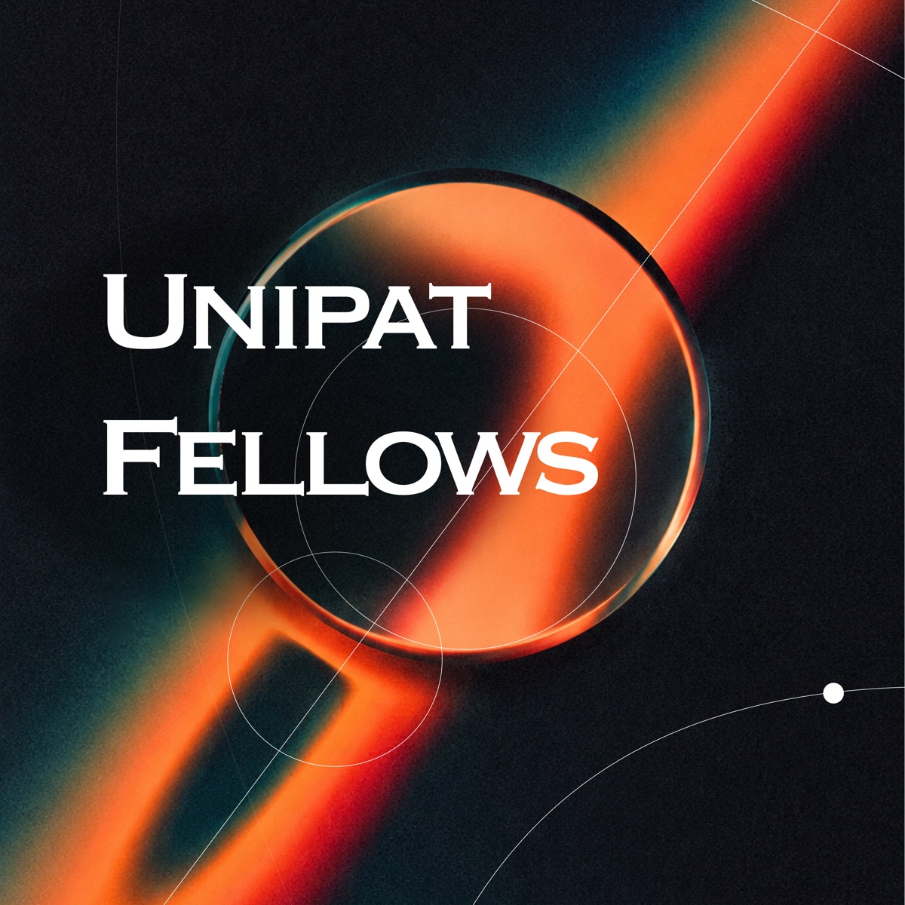

Title: UniPat Fellows: Investing $15 Million to Reshape How Science Is Done
Date: 2026-11-04
Summary: UniPat Fellows brings scientific research and model development into the same feedback loop. Fellows work alongside our researchers and engineers to tackle important problems that AI still can’t solve—but should.
HeaderImage: /static/images/fellows/cover-standard-1200.jpg
Layout: feature

<aside class="fw4-banner" aria-label="Applications open">

<strong>Applications open</strong>UniPat AI Exploration Lab

<a class="fw4-banner-cta" href="mailto:fellows@unipat.ai?subject=UniPat%20Fellows%20Application">APPLY →</a>
</aside>
<header class="fw4-hero">

<h1>UniPat Fellows: Investing $15 Million to Reshape How Science Is Done</h1>

UniPat Fellows brings scientific research and model development into the same feedback loop. Fellows work alongside our researchers and engineers to tackle important problems that AI still can’t solve—but should.

<a class="fw4-btn is-primary" href="mailto:fellows@unipat.ai?subject=UniPat%20Fellows%20Application">Apply now →</a>
<a class="fw4-btn is-ghost" href="#exploring">See what Fellows explore</a>

<figure class="fw4-cover"></figure>
</header>
<dl class="fw4-facts">

<dt>Investment</dt><dd>$15M<small>over the next year</small></dd>

<dt>API credits</dt><dd>$75K<small>frontier-model access</small></dd>

<dt>Formats</dt><dd>2 ways<small>full-time or project-based</small></dd>

<dt>Work mode</dt><dd>Onsite / Remote<small>flexible options</small></dd>

</dl>

<section class="fw4-sec" id="why">

Why Fellows

<h2>Bridging Science and AI, Starting with Questions That Matter</h2>

Across disciplines, researchers see opportunities for AI to advance their work. Yet domain researchers and AI teams often work separately, with limited opportunities for sustained collaboration.

<article class="fw4-side">

Domain researchers

<h3>Questions that matter.</h3>

Know how to frame research problems and judge the results.

May needDedicated AI research and engineering support.

</article>
<article class="fw4-side">

AI teams

<h3>Models and tools.</h3>

Bring expertise in AI research and engineering.

May needDomain knowledge to define tasks and validate results.

</article>

<strong>UniPat Fellows</strong>
Working together on shared research problems.

We’re launching <strong>UniPat Fellows</strong> at the UniPat AI Exploration Lab to bring domain researchers and AI teams together around shared research problems.

Fellows bring hard questions and deep domain expertise. Our researchers and engineers work alongside them to turn those questions into tasks for evaluating and training models. As models improve, they can help Fellows advance the research that inspired those tasks.

UniPat AI will invest $15 million over the next year in this effort. Inspired by Bell Labs’ approach to collaborative research, we provide models, compute, and experimental support so researchers can pursue difficult questions together.

</section>
<section class="fw4-sec" id="how">

The process

<h2>How Fellows Work</h2>

Each Fellow starts with a problem from their own research. Together, we identify tasks that still depend on expert researchers and explore what it would take for AI to perform them reliably.

<ol class="fw4-steps">
<li><b>Benchmarks</b> establish a baseline for model performance and reveal where models fall short.</li>
<li><b>Interactive environments</b> give models access to specialized tools and simulations, with real-world feedback guiding their next steps.</li>
<li><b>Training.</b> The resulting tasks and feedback provide the basis for model training.</li>
<li><b>Evaluation.</b> Subsequent evaluations assess whether model performance on these research tasks has improved.</li>
</ol>

Our scope spans physics, chemistry, biology, medicine, materials, chip design, and beyond. What matters is whether the problem is important—and whether progress can be tested against observable results.

<ul class="fw4-chips" aria-label="Research domains"><li>Physics</li><li>Chemistry</li><li>Biology</li><li>Medicine</li><li>Materials</li><li class="is-last">Chip design</li></ul>
</section>
<section class="fw4-sec" id="exploring">

Current work

<h2>What Fellows Are Exploring</h2>

<article class="fw4-case">
<svg viewBox="0 0 44 44" fill="none" stroke="currentColor" stroke-width="1.5" aria-hidden="true"><rect x="4" y="15" width="36" height="14" rx="2"/><path d="M4 22c4-5 8 5 12 0s8 5 12 0 8 5 12 0"/></svg>
<h3>Optical chip design</h3>

Peking University · Physics

A Fellow from Peking University with a background in physics is exploring automated optical chip design. Models use electromagnetic simulation tools to work toward design objectives, analyze optical fields and device responses, and refine their designs based on simulation feedback.

</article>
<article class="fw4-case">
<svg viewBox="0 0 44 44" fill="none" stroke="currentColor" stroke-width="1.5" stroke-linecap="round" aria-hidden="true"><path d="M22 40V24M22 24 10 8M22 24 34 8M16 16l-6 4M28 16l6 4"/><circle cx="10" cy="8" r="2.5"/><circle cx="34" cy="8" r="2.5"/></svg>
<h3>Antibody design &amp; engineering</h3>

Peking University · Pharmacy

A Fellow working in pharmaceutical research at Peking University is investigating automated antibody design and engineering. Models draw on sequence, structural, and experimental data to propose mutations, then use wet-lab feedback to guide the next round of experiments. The research examines whether AI can participate meaningfully in a continuous cycle of design, experimentation, feedback, and redesign.

</article>
<article class="fw4-case">
<svg viewBox="0 0 44 44" fill="none" stroke="currentColor" stroke-width="1.5" aria-hidden="true"><rect x="6" y="6" width="32" height="32" rx="2"/><rect x="12" y="12" width="9" height="9"/><rect x="25" y="12" width="7" height="14"/><rect x="12" y="25" width="9" height="7"/><path d="M21 16.5h4M16.5 21v4"/></svg>
<h3>Chip layout design</h3>

UCLA · Chip design

A Fellow from UCLA is exploring automated chip layout design. Models operate professional design tools to generate and modify layouts under complex constraints, using verification and simulation feedback to improve their work.

</article>
<article class="fw4-case">
<svg viewBox="0 0 44 44" fill="none" stroke="currentColor" stroke-width="1.5" stroke-linecap="round" aria-hidden="true"><path d="M5 38h34M5 38V6"/><path d="M8 32c6 0 8-20 14-20s8 14 14 14" stroke-dasharray="2 3"/><circle cx="22" cy="12" r="2.5"/></svg>
<h3>Probabilistic forecasting</h3>

Prediction markets

Other researchers are exploring probabilistic forecasting, including questions drawn from prediction markets. Forecasts are made before outcomes are known and evaluated as events unfold. Across many resolved events, researchers can assess whether models identify useful signals in noisy information and produce reliable, well-calibrated forecasts.

</article>

</section>
<section class="fw4-sec" id="fit">

<h2>Who We’re Looking For</h2>
<ul class="fw4-checks">
<li>Deep expertise, exceptional talent, or distinctive research taste in your field</li>
<li>Belief in AI’s potential to substantially advance your discipline</li>
<li>AI as an integral part of your research or work</li>
</ul>

<h2>What We Provide</h2>
<ul class="fw4-checks">
<li>Close collaboration with our research and engineering teams.</li>
<li>Frontier-model API credits valued at $75,000.</li>
<li>Compute, specialized data, access to domain experts, and research tools.</li>
<li>Competitive compensation.</li>
</ul>

</section>
<section class="fw4-sec" id="join">

Formats

<h2>Two Ways to Join</h2>

Long-term
<h3>Full-time Fellow</h3>
Join UniPat AI to pursue long-term research and real-world applications.

3 months or longer
<h3>Project-based Fellow</h3>
Work with us on a project for three months or longer while continuing your academic or professional commitments.

</section>
<section class="fw4-final" id="apply">

The question that starts every Fellowship

<blockquote>“What is a problem in your field that AI still can’t solve, but should?”</blockquote>
<a class="fw4-btn is-primary" href="mailto:fellows@unipat.ai?subject=UniPat%20Fellows%20Application">Email fellows@unipat.ai →</a>
</section>

<aside class="fw4-rail">

<h2>How to Apply</h2>

fellows@unipat.ai

<ol>
<li>Your CV.</li>
<li>1–2 selected projects or publications.<small>If you have used AI in your research or projects, please include examples.</small></li>
<li>The one problem you’d pursue over the next three months—and why.<small>What is a problem in your field that AI still can’t solve, but should?</small></li>
</ol>
<a class="fw4-btn" href="mailto:fellows@unipat.ai?subject=UniPat%20Fellows%20Application">Apply via email →</a>

<nav class="fw4-rail-nav" aria-label="On this page">
<a href="#why">Why Fellows</a>
<a href="#how">How Fellows work</a>
<a href="#exploring">What Fellows explore</a>
<a href="#fit">Who &amp; what we provide</a>
<a href="#join">Two ways to join</a>
</nav>
</aside>

